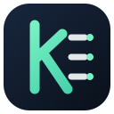

<div align="center">



# kport

**See what owns your ports. Stop conflicts safely.**

A port manager for local development, with a live terminal dashboard and a native SwiftUI app for macOS.

[](https://github.com/tyzrex/kport/actions/workflows/ci.yml)
[](https://github.com/tyzrex/kport/releases/latest)
[](LICENSE)

</div>

## Get started

### Install the command line tool

**macOS / Linux** — install the latest release (or build with Go 1.23+):

```sh
curl -fsSL https://raw.githubusercontent.com/tyzrex/kport/main/install.sh | sh
```

Or install directly with Go:

```sh
go install github.com/tyzrex/kport/cmd/kport@latest
```

Make sure Go's bin directory is on your `PATH` (`$(go env GOPATH)/bin`). Download standalone archives from [GitHub Releases](https://github.com/tyzrex/kport/releases/latest). On Windows, install with Go or download the Windows archive and place `kport.exe` on your `PATH`.

### Install the macOS app

The app is SwiftUI and currently built locally. Install Go and Xcode, clone the repository, then run:

```sh
git clone https://github.com/tyzrex/kport.git
cd kport
macos/KPort/Scripts/build-app.sh
open dist/KPort.app
```

The script builds a self-contained, ad hoc signed `dist/KPort.app` for this Mac, including the matching Go CLI and app icon. Drag it into Applications to keep it there. The app refreshes listeners automatically; use the toolbar search and protocol filter to narrow the list. Select a listener to inspect it, then choose **Stop Process…** to review the affected ports before confirming.

For development, set `KPORT_CLI_PATH` to use a separately built CLI. Release downloads for the signed macOS app are not published yet; the app is not notarized, so macOS may ask you to approve opening it.

### First commands

```sh
kport --json --list             # List listeners without stopping anything
kport --inspect 3000            # Inspect a port
kport -d 3000                    # Preview an action
kport 3000                       # Stop gracefully, then force after timeout
kport                            # Open the live terminal dashboard
```

Both `kport` and `killport` command names are available. The app and CLI use the same Go process manager and protection rules.

## JSON interface for apps

Native frontends can request listener data and a reviewable action plan. Execution rechecks the plan before stopping anything:

```sh
kport --json --list
kport --json --plan 3000 > plan.json
kport --json --execute-plan plan.json
```

Action results include stable `error_code` and readable `error` fields.

## Everyday commands

```sh
kport                              # Live dashboard in a terminal; list when piped
kport --inspect 3000                # Inspect without stopping anything
kport -d 3000                      # Dry run
kport 3000                         # Graceful stop, then force after timeout
kport 3000 -t 5s -W                 # Allow 5s to exit, then verify port release
kport -f 3000                      # Force immediately
kport -T 3000                      # Also stop descendant processes
kport -i 3000 8080                  # Confirm each process/container
kport 3000-3005 8080,9000            # Ranges and comma-separated ports
kport next                         # Framework preset
kport .                            # Stop verified processes in this project
kport free 3000                    # Suggest free ports, one per line
kport -l --sort memory              # List by memory, largest first
kport -l --user alice               # Exact user filter
kport -l --project ./apps/api       # Project and descendant directories
kport -l --exposure public          # Wildcard bindings
kport --json --inspect 3000         # Structured process information
```

Flags work before or after positional arguments. `--inspect`, `--dry-run`, and `--list` never stop processes. With `--ui`, they make dashboard actions previews too.

Stopping a process affects **all its listening ports**. Execution discovers sibling sockets, checks their protection, and returns results for affected sockets. A container action affects the whole container. `-T` additionally affects descendant processes.

`-W` / `--wait` verifies listener disappearance and actual IPv4/IPv6 socket availability. A release timeout is an error and produces a nonzero exit status, including with `--quiet` and `--json`. Use `--wait-timeout 10s` to change the default 5s release timeout. A free-port suggestion or successful wait is a point-in-time check; another process can bind immediately afterward.

## Live dashboard

The dashboard refreshes every second, groups ports by process/container, stays open after actions, and adapts to terminal dimensions. It also stays open when no listeners exist. `--interval 500ms` changes refresh cadence (minimum dashboard interval: 250ms).

| Key | Action |
|---|---|
| `↑` / `↓`, `j` / `k` | Navigate owners |
| `Home` / `End`, `Page Up` / `Page Down` | Jump / page through owners |
| `/` | Enter search mode |
| `Enter` while searching | Keep the filter and return to navigation |
| `Esc` while searching | Clear search and return to navigation |
| `Ctrl-U`, Backspace | Clear / edit search text |
| `Space` | Toggle the highlighted owner |
| `a` / `A` | Toggle visible owners / clear every selection |
| `Enter` | Toggle details and actions |
| `x` / `F` | Stop with configured policy / force stop; review impact, then `y` confirms |
| `n` / `Esc` during confirmation | Cancel |
| `r` / `p` | Refresh / pause automatic refresh |
| `s` | Cycle port, memory, project, user, name, protocol sorting |
| `e` | Cycle all, localhost, public, interface binding filters |
| `c`, then `p` / `o` / `c` / `u` | Copy PID / ports / command / HTTP URL |
| `?` | Controls help |
| `q` / `Ctrl-C` | Quit |

Search matches all space-separated terms across PID, name, command, CWD/project, user, container, port, protocol, and address. Text input is isolated from action shortcuts; Unicode and bracketed paste are supported. Pasted text opens search instead of executing shortcuts.

The footer counts selected owners, affected sockets, and selections hidden by a filter. Hidden selections remain selected until cleared; confirmation lists their impact. Selections follow process start identities and are removed when that process disappears. Actions revalidate identity before signaling and report failures inline. Details show command, executable, CWD, memory, parent, children, and sockets. Help, details, and long confirmation lists scroll with Page Up / Page Down.

Clipboard requests use OSC 52 and require support/permission in your terminal. HTTP URLs are conveniences; the listening service may use a different protocol. Returning ports show the new PID and parent/supervisor so you can investigate automatic restarts.

`public` means a wildcard bind (`0.0.0.0`, `::`, or `*`), not verified Internet reachability. `interface` means a specific non-loopback address.

## Project ownership and monorepos

`kport .` matches working directories under the current project, resolving symlinks. It reports why a process matched. Framework defaults and configured port numbers are **suggestions**, never proof that an unrelated process belongs to this project. Unverified matches are printed to stderr and skipped; use an explicit port if you intend to target one.

Detection reads common framework manifests, literal `--port` / `-p` / `PORT=` script values, literal Vite/Astro/Nuxt `port:` values, Compose published host ports, and `package.json` workspace services (`apps/*`, `packages/*`, or explicit paths). It does not execute JavaScript configuration or resolve every dynamic environment expression. `.killport.json` presets let a workspace define its own service names.

```sh
kport -d .                         # Review verified ownership
kport --ui --project ./apps/api    # Dashboard limited to one service
kport -w 3000 --project .          # Only stop this project's listeners
```

Windows exposes executable, parent, and start identity through native APIs, but another process's CWD and full command line are not available through the limited-information API. Project-scoped actions skip processes without verified CWD ownership.

## Monitoring and automatic termination

```sh
kport --observe 3000               # Never kills; report occupancy changes
kport --observe 3000 --notify      # Also request desktop notifications
kport --observe . --json           # Project events as JSON Lines
kport -w 3000 --name node          # Automatically stop matching processes
kport -w 3000 --user alice         # Restrict by exact owner
kport -w 3000 --project ./apps/api  # Restrict by project
kport -w 3000 --pid 12345          # Pin to this PID's current start identity
```

`--observe` reports initial occupancy, releases, and when no matching listener remains. `--watch` / `-w` continuously stops matches; filters apply on every refresh. When a stopped port returns under a new identity, events include the previous PID and new parent/supervisor PID. Ctrl-C stops either mode. Watch requires explicit ports/presets or `.`; it rejects read-only and interactive-confirmation flags instead of silently ignoring them.

## Protection and Docker

PID 1 and the caller process are protected. SSH, DNS, DHCP, and NTP ports have built-in protection, and configuration can add more ports. Protection includes other ports owned by a selected process and listening descendants when tree cleanup is requested. **`--force` does not bypass protected ports**; `--force-protected` is the explicit override.

Docker published ports resolve to container names, including ports without a userland proxy. Stopping one uses `docker stop`; force uses `docker kill`. Container mappings are rechecked before action. Shared Docker backends are never directly killed when container ownership cannot be resolved. Compose's working-directory label enables verified project filtering for containers. Queries are bounded; without an accessible Docker engine, ordinary process management still works.

## Configuration

Global `~/.killport.json` and `~/.config/killport/config.json` are merged with `.killport.json` files from ancestor directories through CWD. Nearer files override scalar preferences and preset names. Protected-port lists accumulate. Malformed files and invalid ports/timeouts produce an explicit error.

```json
{
  "presets": {
    "api": [4100, 4101],
    "frontend": [5173]
  },
  "protected_ports": [5432, 6379],
  "default_force": false,
  "default_tree": false,
  "default_timeout": "3s"
}
```

CLI flags override defaults. `--graceful` overrides `default_force`; `--tree=false` disables `default_tree`.

Built-in presets include `dev`/`web`, `db`/`database`, `next`, `react`, `remix`, `vite`, `svelte`, `astro`, `vue`, `angular`, `django`, `fastapi`, `flask`, `rails`, `postgres`, `mysql`, `mariadb`, `redis`, `mongo`, and `elastic`. Preset names describe default ports, not verified framework identities.

## Scripting and shell completion

List/inspect/dry-run JSON is an array of process records. Stop JSON is an array of per-socket results with `killed`, `signal`, and an error string when applicable; watch emits one JSON object per event. Empty results are `[]`. `--quiet` suppresses stdout while preserving failure status and stderr diagnostics. Exit status is 0 on success and 1 on argument, discovery, stop, or release-verification failure.

```sh
source <(kport completion bash)
source <(kport completion zsh)
kport completion fish > ~/.config/fish/completions/kport.fish
kport completion powershell
```

## Go library

```go
package main

import (
    "fmt"
    "log"
    "time"

    "github.com/tyzrex/kport"
)

func main() {
    processes, err := killport.Find(3000)
    if err != nil { log.Fatal(err) }
    for _, p := range processes {
        fmt.Printf("PID %d: %s (%s)\n", p.PID, p.Name, p.Cwd)
    }

    opts := killport.DefaultKillOptions()
    opts.Timeout = 3 * time.Second
    opts.WaitForFree = true
    results, err := killport.KillPorts([]int{3000}, opts)
    if err != nil { log.Fatal(err) }
    for _, r := range results {
        if r.Error != nil { log.Printf("PID %d: %v", r.Process.PID, r.Error) }
    }
}
```

Additional APIs include `FindAll`, `FindByName`, `GetProcessDetails`, `KillProcess`, `WaitForFree`, `FindFreePorts`, and `Watch`. The library operates on OS processes; Configuration, protected-port policy, and Docker actions are implemented by the shared internal application service. Library `Watch` reports stop failures to its callback and returns discovery errors.

## Shared application behavior

The CLI, terminal dashboard, and future desktop adapters share `internal/app.Service`
for discovery, Docker integration, protected-port policy, and action execution.
Each service copies its configured presets and protections; loading a project does
not change the library's global defaults or another application session.

Tree actions pin descendant process identities before checking protection. If a
new or replaced descendant appears before execution, the action fails and asks
for a refresh instead of extending the approved target set.

`FindOptions.Context` and `KillOptions.Context` support cancellation. The library
also provides `GetProcessDetailsContext` and `WaitForFreeContext`. OS query commands
have a three-second deadline, and Docker discovery retains its two-second budget.
Cancellation stops pending work and escalation; it cannot undo signals already sent.

Desktop adapters can call `Service.PrepareAction` to get an `ActionPlan` containing
the selected owners, affected sockets, and safety issues. `ExecutePlan` rediscovers
and compares the impact before acting; a changed plan returns `stale_plan` results.
Action results include stable `error_code` values such as `protected_target`,
`permission_denied`, `identity_changed`, `mapping_changed`, `timed_out`, and
`discovery_failed`, while retaining the human-readable error message.

macOS discovery distinguishes normal `lsof` no-match results from failures, and
fails explicitly on command errors instead of reporting an empty listener list.
Process metadata is collected in batches per snapshot, with start identities
rechecked afterward. Working directories and memory remain fresh, since caching
working directories could produce incorrect project ownership matches.

## Development

```sh
go test -race ./...
go vet ./...
make build
python3 scripts/check-tui.py ./bin/kport   # Real-terminal interaction checks on Unix
```

Tests start isolated Go listener subprocesses and do not require Python except for the optional PTY check. CI runs tests on Linux, macOS, and Windows with Go 1.23 and 1.26.

## License

MIT © [tyzrex](https://github.com/tyzrex)
